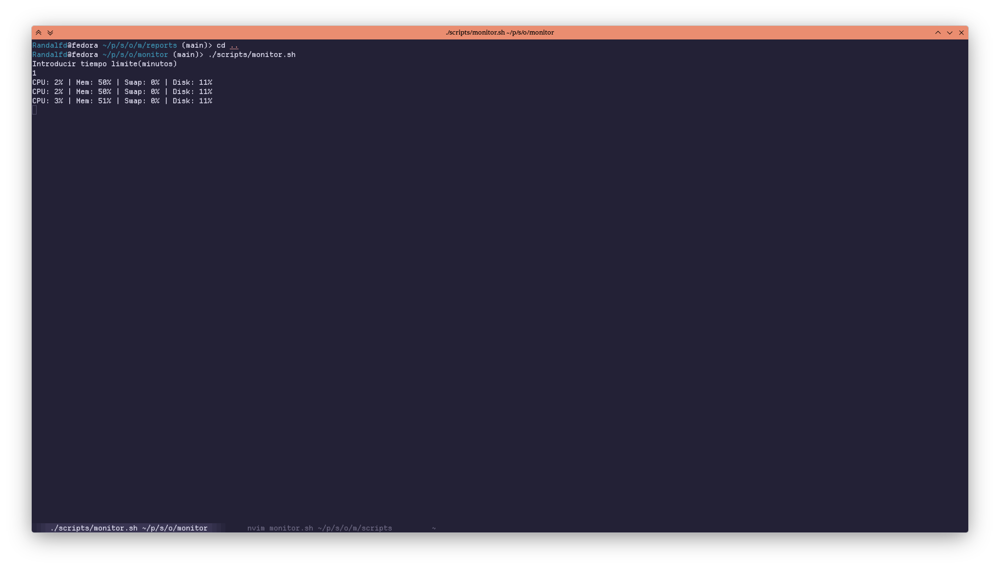
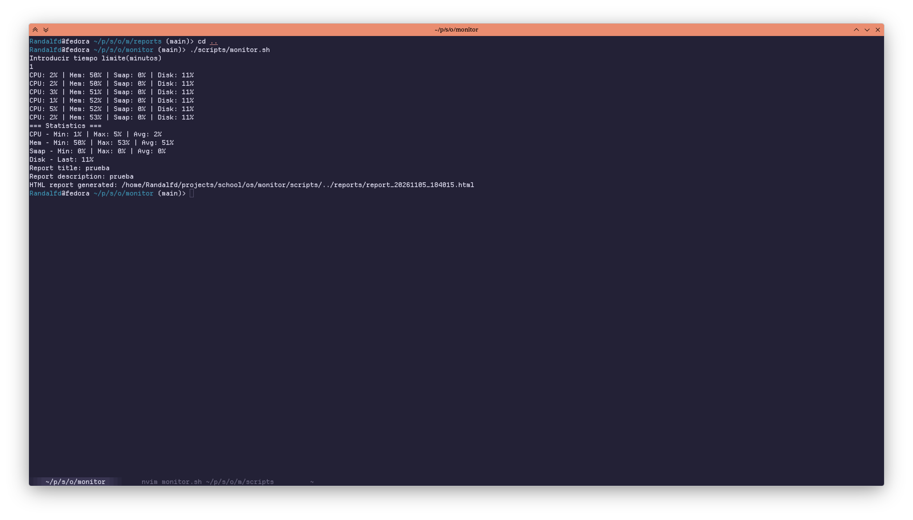
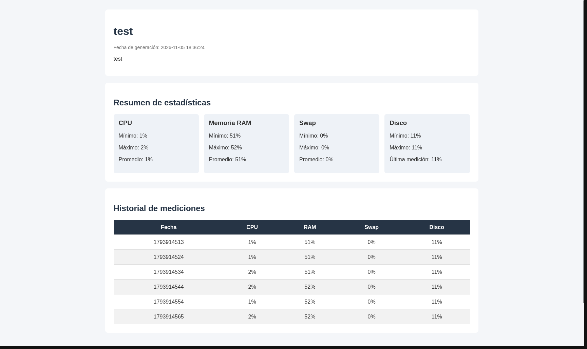
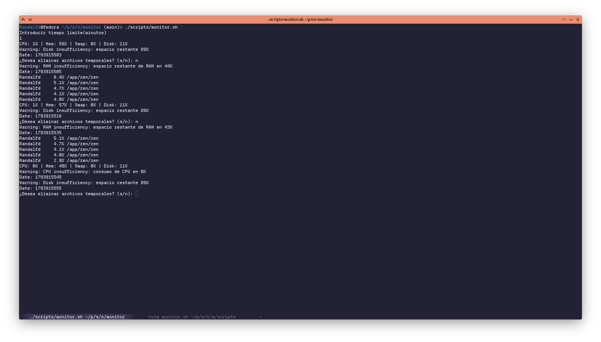
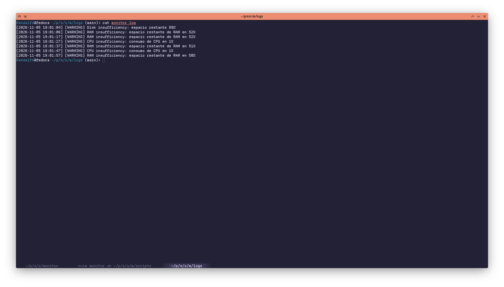

# Monitor Script

Script de monitoreo de recursos del sistema.

Recreacion del script de monitoreo `scripts/monitor.sh` en **PowerShell** (`scripts/Monitor.ps1`, ejecutable con `pwsh`), manteniendo las mismas caracteristicas: captura periodica de CPU, Memoria, Swap y Disco, calculo de estadisticas, alertas con envio de mail y generacion de reporte HTML.

## Dependencias

- **PowerShell 7+** (`pwsh`) — runtime principal del script.
- **top**, **free**, **df**, **ps** — utilidades del sistema para capturar CPU, Memoria, Swap, Disco y procesos.
- **sendmail / servidor SMTP** — modulo de mails de alertas (via `Send-MailMessage`).
- **Plantilla HTML** — `templates/report_template.html`, procesada reemplazando los placeholders `${...}`.

## Estructura del proyecto

- `scripts/Monitor.ps1` — script principal en PowerShell (contratos DTO, funciones auxiliares, bucle, alertas, mail, reporte HTML).
- `scripts/monitor.sh` — version original del script en bash.
- `dto/` — contratos de datos (`StatusDto`, `TableDto`, `AlertDto`).
- `templates/report_template.html` — plantilla HTML de los reportes.
- `reports/` — reportes HTML generados.
- `logs/monitor.log` — log de monitoreo.
- `img/` — imagenes del proyecto.

## Features Implementadas

### 1. Registro de datos (CPU, Memoria, Swap, Disco)

El bucle principal captura cada 10 segundos los valores de:

- **CPU**: uso actual en porcentaje (`user + system`)
- **Memoria**: porcentaje de memoria usada
- **Swap**: porcentaje de swap usado
- **Disco**: porcentaje usado de `/`

Los valores se almacenan en el `StatusDto` (contrato de intercambio de informacion) y se imprimen en cada iteracion.

### 2. Estadisticas finales

Al terminar el tiempo configurado, se calculan y muestran usando el `TableDto`:

- **CPU / Memoria / Swap**: Minimo, Maximo y Promedio (media de todas las capturas)
- **Disco**: Ultimo valor capturado

### 3. DTOs (Contratos de datos)

- `StatusDto`: `timestamp`, `cpu`, `ram`, `swap`, `disk` — metricas de cada iteracion
- `TableDto`: `timestamp`, `minCpu`, `minRam`, `minSwap`, `minDisk`, `lastDisk`, `avgCpu`, `avgRam`, `avgSwap`, `maxCpu`, `maxRam`, `maxSwap`, `maxDisk` — estadisticas agregadas

### 4. Alertas

- **CPU**: si en 3 ciclos consecutivos se detecta consumo alto, alerta y envia mail al administrador.
- **Disco**: si el espacio restante es bajo, alerta y pregunta si desea eliminar archivos temporales.
- **RAM**: si la RAM < 10%, alerta y lista los 5 procesos de alto consumo de RAM.

Solo se envia el mail de alerta para alertas de CPU.

## Salida

- Reporte HTML generado en `reports/report_<timestamp>.html`.
- Log en `logs/monitor.log`.

## Visuales

Imágenes del proyecto:











## Uso

```powershell
pwsh -File scripts/Monitor.ps1
# Introducir tiempo limite(minutos): <valor en minutos>
# Espera a que finalice el tiempo y muestra estadisticas
```

## Bash original

```bash
bash scripts/monitor.sh
```
